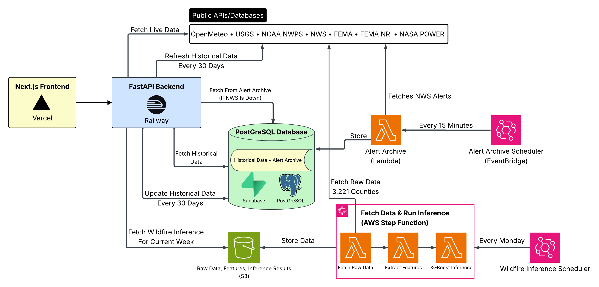

# Risk Resource

Natural disaster information is spread across many different agency websites and can be hard to access when they're needed. Risk Resource was built to help residents understand the natural disasters that could affect their home during any season and stay up-to-date with live monitoring and personalized steps to help stay prepared.

## What It Does

Risk Resource is a website that scores every US state and county for six natural hazards: **wildfire, earthquake, flood, severe storm, hurricane and tornado**. It combines nearly two decades of disaster history with what's happening right now, so you can see both what usually threatens a place and what threatens it this week.

**Home page (`/`)**
- Search for any US street address, city, ZIP code or county to jump straight to its county on the risk map.
- An animated US map that cycles through five hazards, coloring each state by its score.
- A live score card for a list of saved places. You can add your own (by address, city, ZIP or county) or remove them, and the list is remembered in your browser.

**Risk map (`/map`)**
- An interactive map you can switch between **states** and **counties**, or zoom from a state into its counties.
- Color the map by the **overall risk score**, a single hazard's score, **expected annual loss** (total or per person), **social vulnerability** or **community resilience**.
- Click any state or county to open a side panel with:
  - The overall risk score (0 to 100) and its tier: **Low** (0–29), **Moderate** (30–49), **Elevated** (50–74) or **Critical** (75–100)
  - A score for each hazard, with the reasons behind it (for example "Red Flag Warning active" or "M4.9 earthquake 9 km N of ...")
  - A dropdown listing the active NWS weather alerts for that area
  - For counties, those reasons also draw on the next 24 hours of wind and fire weather and on nearby river gauge flood levels
  - This week's wildfire model estimate: the chance a large wildfire starts in the county
- Below the map, FEMA's estimate of the dollars the selected area loses to each hazard in an average year.
- Search the map by county, city, ZIP code or street address.

The same tier colors are used everywhere on the site (badges, hazard bars, map shading and the /about page), so a color always means the same tier. The site has a light and a dark theme.

**About page (`/about`)**
- A plain-language explanation of how the score is built, what each data source contributes and how FEMA's expected loss figures work.

## Approach

Every score is on a 0 to 100 scale. The **overall risk score** is built from three parts:

| Part | Weight | What it measures | Where it comes from | How often it updates |
|------|--------|------------------|---------------------|----------------------|
| **Historical baseline** | 40% | How often each hazard has hit the area since 2006 | FEMA disaster declarations, USGS earthquake history | Automatically rebuilt once it's 30 days old |
| **Live signal** | 40% | What's happening right now | NWS alerts, recent USGS earthquakes, Open-Meteo forecast, NOAA river gauges | Every few minutes, on demand |
| **Wildfire model** | 20% | The chance a large wildfire starts in the county this week | XGBoost model run on NASA POWER and Open-Meteo weather | Weekly (Mondays), on AWS |

How the parts fit together:

1. **Each hazard gets its own score.** Its historical baseline (a percentile against every other county) and its strongest live signal are blended 50/50. For example, a Flash Flood Warning, a river gauge at "major" flood stage, or a magnitude 5.5+ quake within 20 miles each push the live part up.
2. **The hazards are combined, weighted toward the worst.** A plain average would let hazards that don't apply (hurricanes in Nevada) hide the one that does, so the combined score is 60% the highest hazard and 40% the average of the top three.
3. **The wildfire model is added last**, as 20% of the overall score. This gives the overall score a deliberate wildfire lean. If the weekly model results are missing or out of date, the overall score uses the hazards alone rather than counting the model as zero.

**The wildfire model** is a machine learning model (XGBoost) trained on large wildfires from 2010 to 2020 and tested on 2021 to 2024, so it's always judged on years it never saw. It looks at recent heat, dryness, humidity, wind, rainfall, soil moisture and each county's fire history. On the test years it beat a history-only baseline, and the 5% of county-weeks it rated riskiest contained 74% of the fires that actually started. Details are in [`backend/ml/wildfire/README.md`](backend/ml/wildfire/README.md).

**Expected annual loss is shown separately from the score.** It's FEMA's estimate, in dollars per year, of the building, agriculture and human losses from each hazard. It doesn't change with the weather and isn't part of the risk score, so the site labels it as a FEMA estimate.

Each part is kept separate so every score can be explained: the side panel shows which alerts, forecasts or historical counts produced it.

## Data

Everything comes from free, public sources. None of them need an API key; every request identifies itself with the User-Agent `UCSD-Risk-Resource-NotForProfit`.

### Live data (fetched while the site is running)

| Source | What we collect | Used for |
|--------|-----------------|----------|
| [NWS Active Alerts API](https://www.weather.gov/documentation/services-web-api) | Every active US weather alert: event type (e.g. "Tornado Warning"), severity, headline, and the counties it covers | Live signal for every hazard except earthquake, and the alert list in each side panel. Refreshed every 5 minutes |
| [USGS Earthquake Catalog API](https://earthquake.usgs.gov/fdsnws/event/1/) | Earthquakes of magnitude 3.0+ in the past 7 days: location, magnitude and place name | Live earthquake signal, scored by magnitude and distance. Refreshed every 5 minutes |
| [Open-Meteo Forecast API](https://open-meteo.com/en/docs) | The next 24 hours at a county's center: wind gusts, humidity and precipitation | Severe storm (strong gusts) and wildfire (low humidity plus high wind) signals, when a county is opened |
| [NOAA NWPS Gauges API](https://api.water.noaa.gov/nwps/v1/docs/) | River gauges inside a county: name and observed and forecast flood category (action, minor, moderate, major) | Live flood signal, when a county is opened |
| [Open-Meteo Geocoding API](https://open-meteo.com/en/docs/geocoding-api) | US place names with their state and county | Search by city or ZIP code |

### Reference data (stored in the database, rebuilt monthly)

| Source | What we collect | Used for |
|--------|-----------------|----------|
| [OpenFEMA Disaster Declarations Summaries API](https://www.fema.gov/openfema-data-page/disaster-declarations-summaries-v2) | Every disaster declaration since 2006: incident type, state, county and disaster number | Historical baseline for each hazard |
| [USGS Earthquake Catalog API](https://earthquake.usgs.gov/fdsnws/event/1/) (history) | Locations of every magnitude 4.5+ earthquake in the US since 2006 | Historical earthquake baseline |
| [FEMA National Risk Index (NRI)](https://hazards.fema.gov/nri/), via FEMA's ArcGIS service | Per county: expected annual loss for 11 hazards, population, social vulnerability and community resilience ratings (December 2025 release) | Expected annual loss, and the vulnerability and resilience map layers |
| [US Census population estimates](https://www2.census.gov/programs-surveys/popest/datasets/) | County population (2021, with 2019 as a fallback) | Loss per person, state averages and search ranking |
| [Plotly US counties GeoJSON](https://raw.githubusercontent.com/plotly/datasets/master/geojson-counties-fips.json) | County names, FIPS codes and boundaries | The county list, county locations and the map's shapes |

### Wildfire model data (fetched weekly, outside the website)

| Source | What we collect | Used for |
|--------|-----------------|----------|
| [NASA POWER Daily API](https://power.larc.nasa.gov/docs/services/api/) | 180 days of daily weather for about 1,900 grid cells covering the US: max temperature, dew point, humidity, max wind, precipitation and soil wetness | The model's weather inputs, and its training data |
| [Open-Meteo Forecast API](https://open-meteo.com/en/docs) | Daily forecast for the same cells | Fills in the days NASA POWER hasn't published yet |
| [MTBS fire occurrence data](https://www.mtbs.gov/) (training only) | Large wildfires since 1984: ignition date and location | The model's training labels and each county's fire history |
| [Open-Meteo Elevation API](https://open-meteo.com/en/docs/elevation-api) (training only) | Elevation at each county's center | A model input |

### Address search (called from the visitor's browser)

| Source | What we collect | Used for |
|--------|-----------------|----------|
| [Photon](https://photon.komoot.io/) (OpenStreetMap data) | Address and place suggestions with their coordinates, limited to the US | Suggestions as you type in any search box |
| [FCC Census Area API](https://geo.fcc.gov/api/census/) | The county FIPS code for a latitude and longitude | Turning a chosen address into a county |
| [Nominatim](https://nominatim.openstreetmap.org/) (OpenStreetMap) | One geocoded result for the typed text | Home page search, when there's no suggestion to pick |

Exactly how each source is called, which fields are read, and each one's rate limits are in [docs/apis-usage.md](docs/apis-usage.md).

## Tech Stack

| Area | Tools |
|------|-------|
| Frontend | Next.js, React, TypeScript, Tailwind CSS, Leaflet, hosted on Vercel |
| Backend API | Python, FastAPI, Pydantic, httpx, psycopg, hosted on Railway |
| Database | PostgreSQL, hosted on Supabase |
| Machine learning | XGBoost, scikit-learn (calibration), pandas, Shapely, Jupyter, matplotlib |
| Cloud (AWS) | Lambda, EventBridge, Step Functions, S3, ECR, CloudWatch Logs (see below) |

### AWS

AWS runs the two jobs that happen on a schedule, outside the API:

| Service | What it does |
|---------|--------------|
| **AWS Lambda** | Runs the NWS alert archiver and the three steps of the weekly wildfire pipeline |
| **Amazon EventBridge** | Triggers the alert archiver every 15 minutes, and starts the wildfire pipeline every Monday at 06:00 UTC |
| **AWS Step Functions** | Runs the wildfire pipeline in order: download weather in 8 chunks, build the model's features, then score and publish. It's split up because the whole job takes about 30 minutes, longer than Lambda's 15-minute limit, and it retries chunks when NASA POWER rate-limits us |
| **Amazon S3** | Stores the pipeline's weather downloads and features, and the published weekly scores (`wildfire/latest.json`) that the API reads |
| **Amazon ECR** | Holds the container image the wildfire Lambdas run from (model, artifacts and code) |
| **Amazon CloudWatch Logs** | Keeps each function's logs |

- **NWS alert archiver** ([`backend/aws/lambda_function.py`](backend/aws/lambda_function.py)): NWS only serves alerts that are active *now*, so every 15 minutes this copies them into Supabase. That builds a year of alert history per county and gives the API a recent copy to fall back on if NWS goes down.
- **Weekly wildfire pipeline** ([`backend/aws/wildfire_steps.py`](backend/aws/wildfire_steps.py), [`wildfire_state_machine.json`](backend/aws/wildfire_state_machine.json)): downloads the weather, runs the wildfire model for every county and publishes the scores to S3. The model itself runs in under a second, so it needs no SageMaker.

The monthly reference data rebuild doesn't use AWS. The API does it itself: every hour it checks how old the data in Supabase is, and once it's more than 30 days old it rebuilds it from FEMA, USGS, Census and the NRI and swaps it in without a restart. If a source fails, the old data stays. `/api/health` shows when the data was built and when the next rebuild is due.

### Architecture



## Repository Structure

```text
RiskResource/
├── backend/                 FastAPI service, data pipeline and wildfire model (see backend/README.md)
│   ├── app/                 The API
│   │   ├── clients/         One client per upstream API (NWS, USGS, NWPS, Open-Meteo)
│   │   ├── core/            In-memory cache for live feeds
│   │   ├── domain/          Scoring rules and hazard tables, no I/O
│   │   ├── routers/         HTTP endpoints, one module per endpoint group
│   │   └── services/        Builds responses, plus the alert fallback and monthly data refresh
│   ├── aws/                 AWS Lambda code, container image and Step Functions definition
│   ├── data/                Committed reference data snapshot that seeds an empty database
│   │   └── snapshot/        Fixed scores for the home page's hazard map animation
│   ├── db/                  Postgres schema
│   │   └── migrations/      Schema changes for existing databases
│   ├── ml/
│   │   └── wildfire/        Wildfire model: dataset building, training and weekly scoring
│   │       ├── artifacts/   Trained model, calibration and precomputed features
│   │       └── notebooks/   Data exploration, training results and example predictions
│   ├── scripts/             Database setup and manual reference data rebuild
│   └── weekly_scores/       Shared format and storage for the weekly wildfire scores
├── docs/                    Detailed docs for developers and coding agents
└── frontend/                Next.js site
    ├── app/                 Pages: home, /map and /about
    ├── components/          UI components, grouped by page (about, common, home, map)
    └── lib/                 API calls, types, formatting, tier colors and scoring helpers
├── static/                  Images for this README (the architecture diagram)
```

## Documentation

| Doc | For |
|---|---|
| [backend/README.md](backend/README.md) | Setting up and running the backend |
| [docs/backend-doc.md](docs/backend-doc.md) | The API, scoring model, database, caching and deployment, in detail |
| [docs/frontend-doc.md](docs/frontend-doc.md) | The frontend's structure, data flow, address search and data contract |
| [docs/wildfire-model.md](docs/wildfire-model.md) | The wildfire model end to end: what it predicts, training, the weekly AWS pipeline, and how to operate and retrain it |
| [backend/ml/wildfire/README.md](backend/ml/wildfire/README.md) | The wildfire model's code, features and full results |
| [docs/apis.md](docs/apis.md), [docs/apis-usage.md](docs/apis-usage.md) | Every external API, and exactly how each one is called |

Each doc ends with known issues or limitations where there are any.

## Backend Setup

See [backend/README.md](backend/README.md) for the backend's architecture and details. It needs Python 3.11 or newer.

The API reads its reference data (states, counties, baseline hazard scores) from a
Supabase Postgres database. Only the backend talks to Supabase.

1. Copy `backend/env.example` to `backend/.env` and set `DATABASE_URL` to the
   Supabase **session pooler** connection string, with the real database password.
2. In the same file, set `REFERENCE_MAX_AGE_DAYS=0`. This stops your local backend from
   running the monthly rebuild against the database the whole team shares; the deployed
   backend handles it.
3. Install dependencies: `pip install -r backend/requirements.txt`
4. Start the API (from `backend/`): `python -m uvicorn app.main:app --reload`. It runs
   at http://localhost:8000, with interactive docs at http://localhost:8000/docs.

On startup the API creates any missing tables from `backend/db/schema.sql` and,
if the reference data is empty, seeds it from the committed `data/reference.json`
snapshot. Both happen only once; later startups just read the data.

To replace data that's already seeded by hand (from `backend/`):
- `python -m scripts.init_db --reseed` reloads it from `data/reference.json`
- `python -m scripts.init_db --refresh` rebuilds it from FEMA, USGS, Census and the NRI
  (about a minute), updates `data/reference.json`, then reseeds

Both write to the database the whole team shares.

## Frontend Setup

With the backend running, from `frontend/`:

```bash
npm ci
npm run dev        # http://localhost:3000
```

The site calls the backend at `NEXT_PUBLIC_API_URL`, which defaults to
`http://localhost:8000/api`. The Vercel deployment sets it to the Railway backend's URL
plus `/api`, at build time; see
[docs/backend-doc.md](docs/backend-doc.md#deploying).

## Disclaimer

Risk Resource is intended for informational purposes only and is not a substitute for official warnings or evacuation orders.
