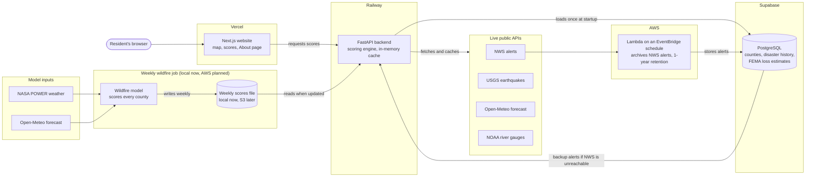

# 3. Tech stack and architecture

## The stack at a glance

| Layer | Technology | Role |
|---|---|---|
| **Website (frontend)** | Next.js 16, React 19, TypeScript, Tailwind CSS, Leaflet maps | The pages people use: home page, interactive map, About page |
| **Website hosting** | Vercel | Serves the frontend |
| **API (backend)** | Python, FastAPI | Combines all the data into scores and serves them to the website |
| **API hosting** | Railway | Runs the API as an always-on server, deployed from `main` |
| **Database** | Supabase (managed PostgreSQL) | Stores the slow-changing reference data: counties, populations, disaster history, FEMA loss estimates |
| **Wildfire model** | Python, XGBoost, scikit-learn, pandas | Trains the model, and scores every county each week |
| **Scheduled cloud jobs** | AWS Lambda + EventBridge | Archives National Weather Service alerts every 15 minutes, keeping a rolling year (see the alert archive writeup). The weekly wildfire job will move to AWS too (planned) |
| **Live data** | Public government and weather APIs | NWS, USGS, NOAA, Open-Meteo, NASA (see the data writeup) |

## How the pieces connect



Plain-text version for a slide:

```
 Browser ──▶ Website (Next.js, Vercel) ──▶ API (FastAPI, Railway) ──▶ Live APIs (NWS, USGS, NOAA, Open-Meteo)
                                                │   ▲
                       loads at startup ◀───────┘   │ reads weekly scores
                                │                   │
                   Database (Supabase Postgres)   Weekly wildfire job (XGBoost)
                                ▲                   ▲
   AWS Lambda (every 15 min, NWS alert archive) ──┘   └── NASA POWER + Open-Meteo weather
```

## How a request flows

1. **A visitor opens the map or searches for a county.** The website asks the API for that area's scores.
2. **The API already has the background data in memory.** At startup it loads counties, disaster history and FEMA loss estimates from the database, about 45,000 small records, so it never waits on the database during a visit.
3. **The API adds live conditions.** Nationwide feeds (weather alerts, earthquakes) are fetched once and cached for a few minutes, so every county on the map benefits. When a visitor opens a single county, the API also fetches that county's weather forecast and nearby river gauges.
4. **The API adds this week's wildfire model score**, from the file the weekly job produced.
5. **The scoring engine combines everything** into hazard scores and the overall score, and sends them back. The website draws the map and the breakdown.

## Design choices worth mentioning

- **Fast and resilient.** Everything is cached, and if any outside source is down, the site still shows scores from the remaining data and says clearly which live data is unavailable. It never says "no alerts" when it couldn't check. If the weather service itself is unreachable, the API falls back to the Lambda's most recent copy of the alerts, labelled with its time.
- **Respectful of free public APIs.** All visitors share the same upstream limits, so nationwide data is fetched once for everyone, and per-county data only when someone opens that county.
- **The model runs separately from the website.** Scoring 3,221 counties needs months of weather data per location and takes about half an hour, so it runs as its own weekly job and publishes a small results file. The API just reads that file. This keeps the website fast and makes it easy to move the job to the cloud.
- **Ready to move to AWS.** The weekly job already has a cloud entry point that an EventBridge schedule can trigger, and switching the results file to Amazon S3 is a configuration change, not a code change.
